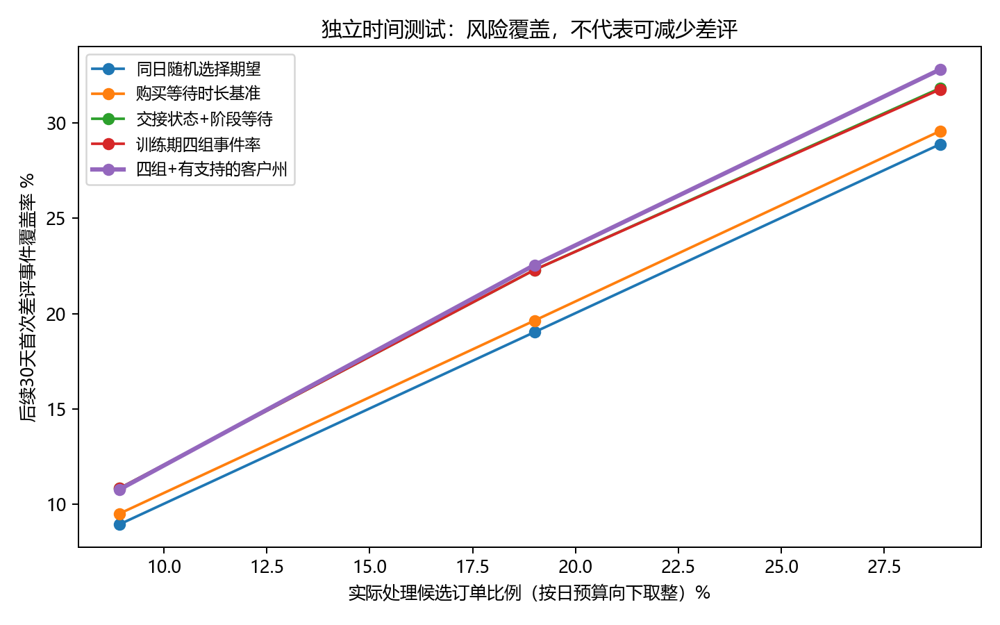
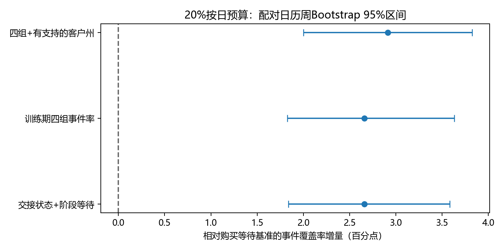

# 电商异常履约订单处置优先级与历史回测

## 研究结论与业务决策表

**开发期预先选定的“四组＋有支持的客户州”通过本研究预设增量门槛，可作为这个新增到期队列的优先级试点候选。** 主独立测试期为2018年1—6月，评价对象是每日刚到“承诺日次日零时”的新增异常订单，不是全量滚动积压。实际企业客服容量未知，10%/20%/30%只是模拟设定。

下表只展示**开发期已冻结的规则**与基准的差别，不根据测试结果更换主规则。覆盖数是历史上落入所选订单的后续首次差评事件，**不是可以避免的差评数**。

| 每日模拟能力 | 测试期处理量 | 预先选定顺序 | 覆盖后续事件 | 购买等待基准覆盖率 | 同日随机期望覆盖率 | 对等待基准增量（百分点，95%区间） | 选中订单事件比例 |
|---|---:|---|---:|---:|---:|---|---:|
| 10% | 420（实际8.92%） | 四组＋有支持的客户州 | 340 / 3,157 = 10.77% | 9.50% | 8.94% | +1.27个百分点［+0.68, +1.82］ | 80.95% |
| 20% | 895（实际19.01%） | 四组＋有支持的客户州 | 712 / 3,157 = 22.55% | 19.64% | 19.03% | +2.91个百分点［+2.00, +3.82］ | 79.55% |
| 30% | 1,359（实际28.86%） | 四组＋有支持的客户州 | 1,036 / 3,157 = 32.82% | 29.59% | 28.89% | +3.23个百分点［+2.18, +4.13］ | 76.23% |

在20%预算下，开发期选定规则覆盖率为 **22.55%**，相对购买等待基准 **+2.91个百分点**，配对周Bootstrap区间为 **[+2.00, +3.82]个百分点**；相对同日随机期望为 +3.52个百分点。测试集描述性最高的候选是“四组＋有支持的客户州”，这并不授权用该结果重新调参或将其替换为已确认的赢家。

## 1. 与原项目的衔接、保护范围

原项目已建立订单治理、评价时序和承诺节点分析。本轮仅研究候选订单中谁先处理，不重做基础报告或新增机器学习模型。此前13,126笔节点候选包括已送达与未见送达；本研究从其中未见送达的 **8,248** 笔开始，基准核对得到30天首次评价7,943笔、首次差评5,501笔，与已有研究相同。实际训练、留出与间隔会使用不同子样本，不把8,248作为每一张表的分母。

九张原始CSV及其他已有报告、代码、指标和交付材料的哈希在`input_hashes.json`记录；结束检查 **93** 个既有文件未变。只在decision_study内新增文件，未初始化Git、提交、上传、发布或部署。

## 2. 决策时点、信息可用性与目标

决策时点T=预计送达日期D之后的次日00:00，即D+1零时，刚进入逾期，不等于已经超期完整24小时。候选须已下单、记录送达事件不存在或晚于T、没有不晚于T的首次评价。评分时间恰好等于T的全体订单数为 0，不把已发生评分算入待处理候选。

主目标：首次评价在 **(T,T+30天]** 且为1–2星。全部候选的观察到首次差评事件比例、首次评价覆盖率、实际评价者差评率分开报告；无评价不是满意。辅助结果为T+30时仍未见送达记录，不能用于优先级。

可以使用的字段是理论上在下单或截至T已发生的事件：购买和承诺时间、客户州、商品/金额快照、截至T的有效交接事件。交接时间晚于T的记录先隐藏；交接早于下单视为交接状态不确定，不用负时长排序。未确认交接不等于商家未发货，记录可能缺失或回填。金额、商品和地区只是当前快照，缺少变更日志，也不能证明线上当时内容相同。

最终送达、未来交接、未来评分、最终订单状态均不进入排序特征。资格判定使用送达/评价事件是否已发生，和按未来结果分高低风险是两件事。代码将所有未来交接、送达、评价事件隐藏后，候选、允许特征和优先级保持相同；独立SQL复算候选和事件数一致。缺少事件入库、取消时间和时区，本研究仅是事件时间历史模拟。

## 3. 时间划分及样本

| 用途 | 实际决策日期 | 候选订单 | 30天首次差评事件（全候选比例） | 30天首次评价（覆盖率） | 评价者差评率 |
|---|---|---:|---:|---:|---:|
| development | 2017-02-08 至 2017-06-30 | 990 | 658（66.46%） | 942（95.15%） | 69.85% |
| validation | 2017-08-01 至 2017-10-31 | 818 | 519（63.45%） | 787（96.21%） | 65.95% |
| training | 2017-02-08 至 2017-10-31 | 2,017 | 1,318（65.34%） | 1,933（95.84%） | 68.18% |
| test | 2018-01-03 至 2018-06-30 | 4,709 | 3,157（67.04%） | 4,547（96.56%） | 69.43% |

内部拟合使用2017年1—6月，2017年7月作为结果成熟间隔，8—10月用于规则家族选择。之后只用2017年1—10月重新估计相同规则的阈值和分组事件率；最晚训练标签窗口结束为 **2017-11-30 00:00:00**，早于2018年1月测试开始。11—12月不用于最终测试。验证集属于完整2017训练期，表中不能相加视为独立样本。

各时期按决策日期划分，不按最终送达或首次评价日期划分。虽然策略没有使用测试标签来定规则，但原项目已经查看过2018年整体数据，因此这是本轮策略的时间留出，不是从未看过的外部盲测。测试截止到6月减少尾部截断，正式抽取时间仍未知，不能保证所有记录具有完整系统观察窗。

## 4. 候选池与规则

测试候选共 4,709 笔，观察到首次差评 3,157 笔，占全部候选 67.04%；首次评价覆盖率 96.56%；评价者差评率 69.43%。30天后仍未见送达 1,150 笔。

全参考候选8,248笔中，交接字段缺失1,465笔、交接发生在T之后214笔、交接早于下单1笔，合为1,680笔未确认有效交接。后两种只用于事后质量计数，排序不使用未来交接的存在与否。商品金额、运费、件数和卖家数各缺628笔，客户州无缺失；金额和商品聚合仅做可用性检查，没有因缺失剔除订单，也没有用金额推断可挽回价值。

| T时物流阶段代理 | 候选数 | 全候选首次差评事件比例 | 评价覆盖率 | 评价者差评率 | 阶段等待中位数 |
|---|---:|---:|---:|---:|---:|
| 未确认有效交接 | 517 | 84.91% | 96.13% | 88.33% | 23.57天 |
| 已观察到有效交接 | 4,192 | 64.84% | 96.61% | 67.11% | 21.00天 |

未确认交接的占比由完整训练期的39.56%变为测试期的10.98%。队列组成已经漂移，训练分组率只是排序分数，不能直接作为线上未来概率。

基准：购买等待时长按T减下单时间倒序；同一T下它更接近“客户总等待/承诺窗口长度”，不是最终延迟天数。随机基准在**同一天**相同预算内不放回选择，既报告固定种子抽样，也给出条件期望和随机抽样区间。

最多三套候选：

- **交接状态＋阶段等待**：未确认有效交接的先处理，组内按购买等待时长；已交接的按截至T的运输等待时长。无训练权重，业务假设明确，未认定责任。
- **训练期四组事件率**：交接阶段×阶段等待是否超过训练期75分位，共四组。未交接的阈值为购买等待 **32.19天**；已交接的阈值为运输等待 **26.38天**。排序按训练分组事件率，向训练总体按50单强度收缩；同分按阶段等待和固定哈希。
- **四组＋客户州**：只有四组内某州训练样本≥100、差评与非差评事件各≥20时使用州内率，向父组按100单收缩，否则回退四组。本轮有 **3** 个支持的州×组组合。使用客户州避免给多卖家订单指定单一线路或商家。

最终训练的四组排序依据如下，含未评价订单的“未观察到差评事件”并不代表满意：

| 组别 | 训练单量 | 首次差评事件 | 训练观察事件率 | 收缩后排序分数 |
|---|---:|---:|---:|---:|
| handoff_unconfirmed / short | 598 | 476 | 79.60% | 78.50% |
| handoff_unconfirmed / long | 200 | 158 | 79.00% | 76.27% |
| in_transit / long | 305 | 196 | 64.26% | 64.41% |
| in_transit / short | 914 | 488 | 53.39% | 54.01% |

若按地理细化规则试点，真正的排序顺序如下；同分再按阶段等待和固定哈希。阈值和分数保留全部精度于冻结JSON，表内仅作展示，不能把它们视为经校准的未来概率：

| 顺序 | T时状态 | 客户州范围 | 训练排序分数 | 建议处置路径 |
|---|---|---|---:|---|
| 1 | 未确认交接，购买等待≤训练阈值 | 其他州（不含SP） | 78.50% | 先核查活跃状态与交接凭据 |
| 2 | 未确认交接，购买等待≤训练阈值 | SP | 78.45% | 先核查活跃状态与交接凭据 |
| 3 | 未确认交接，购买等待>训练阈值 | 全部州（本组无单独州规则） | 76.27% | 先核查活跃状态与交接凭据 |
| 4 | 已交接，运输等待>训练阈值 | 全部州（本组无单独州规则） | 64.41% | 物流跟进与客户信息更新 |
| 5 | 已交接，运输等待≤训练阈值 | RJ | 57.81% | 物流跟进与客户信息更新 |
| 6 | 已交接，运输等待≤训练阈值 | 其他州（不含RJ,SP） | 54.01% | 物流跟进与客户信息更新 |
| 7 | 已交接，运输等待≤训练阈值 | SP | 52.75% | 物流跟进与客户信息更新 |

短等待的未交接组排在长等待组前来自训练分组率及收缩，不是“等待越短越危险”的通用规律。若业务不接受这种细分，不应为了回测分数硬编码到生产系统。

这是简单分组表规则，不是新的分类器或概率效果模型。选择指标预先定为内部验证的20%按日预算覆盖率；选择“四组＋有支持的客户州”后，规则和阈值在`frozen_rules.json`保存并哈希，独立测试后未改变。

内部验证20%预算实际处理137笔，预选规则覆盖106个事件，简单阶段规则覆盖104个，只差2个。家族选择按预定指标执行，但这种微小领先本身不构成“地区信息稳定更优”的证据。

## 5. 完整测试比较与不确定性

| 策略（20%名义预算） | 实际处理订单 | 覆盖首次差评事件 | 事件覆盖率 | 选中事件比例 | 对等待基准增量 | 配对95%区间（百分点） |
|---|---:|---:|---:|---:|---:|---|
| 同日随机选择期望 | 895 | 600.9（期望） | 19.03% | 67.14% | -0.61个百分点 | [-1.37, +0.08] |
| 固定随机抽样 | 895 | 619 | 19.61% | 69.16% | -0.03个百分点 | [-1.06, +0.88] |
| 购买等待时长基准 | 895 | 620 | 19.64% | 69.27% | +0.00个百分点 | [+0.00, +0.00] |
| 交接状态＋阶段等待 | 895 | 704 | 22.30% | 78.66% | +2.66个百分点 | [+1.84, +3.58] |
| 训练期四组事件率 | 895 | 704 | 22.30% | 78.66% | +2.66个百分点 | [+1.83, +3.63] |
| 四组＋有支持的客户州 | 895 | 712 | 22.55% | 79.55% | +2.91个百分点 | [+2.00, +3.82] |

复杂规则相对简单“交接状态＋阶段等待”的附加价值也需要审查：

| 名义能力 | 地理细化多覆盖事件 | 覆盖率增量 | 配对95%区间（百分点） |
|---|---:|---:|---|
| 10% | -2 | -0.06个百分点 | [-0.39, +0.21] |
| 20% | 8 | +0.25个百分点 | [-0.24, +0.70] |
| 30% | 31 | +0.98个百分点 | [+0.23, +1.60] |

20%时，地理细化只比简单交接阶段规则多覆盖 **8** 个事件，增量 **+0.25个百分点**，区间 **[-0.24, +0.70]个百分点**。因此，应把“分阶段核查是否优于纯购买等待”与“是否值得再加入地区细分”分别判断；主要增量不能全部归功于客户州。该比较是复杂度的描述性审计，没有据此重选或调参。

相同资源比例下各策略处理量完全一致；覆盖率=选中订单中的后续首次差评事件/该测试队列所有后续首次差评事件，选中事件比例=选中事件/实际处理量。相对随机、相对等待的提升均在CSV给出绝对百分点和相对倍数；不能把相对倍数称为可减少差评的倍数。

区间用2,000次配对日历周Bootstrap，保留周内日负载与评分共同波动，分数固定不重新拟合；反映该历史时期抽样变动，不是未来保证或因果区间。每一天随机基准的期望捕获数为预算×当天事件比例，可能是小数；它不是实际选中的小数个客户。另用2,000次超几何随机选择给出条件随机区间，与周Bootstrap总体不确定性分开。

预先推荐门槛：20%资源下相对等待覆盖增量至少2个百分点、配对区间下限>0、两个测试子时段同方向。2个百分点是本次展示用的预设筛查门槛，不是企业收益测算。本次结果：**20%覆盖增量至少2个百分点：通过；配对95%区间下限大于0：通过；两个预定测试子时段方向均为正：通过**。多个候选、比例和敏感性结果仅作描述，未做全面多重比较校正，不将事后最佳当成已验证赢家。

## 6. 每日容量和时段稳定性

20%名义比例下，测试期实际选中 **895** 单，有候选的天数 **120**；全部日历日候选量中位 **20.0**、90分位 **69.0**、最大 **130**。每日选择中位 **4.0**、最大 **26**，有队列但整数预算为零的日期 **9** 天。

预算为floor(比例×当日新队列量)，不额外保证小队列至少处理1单，不结转未用小数或未选订单。整数预算被100%用满是算法定义，不是客服运营效率；相对理论浮点预算的利用率为 **95.03%**，实际服务比例 **19.01%**。本轮没有模拟跨日继续等待、历史已处理标记、人工处理时长或真实客服容量。

| 测试子时段，20%预算 | 候选量 | 冻结规则覆盖率 | 相对等待增量 |
|---|---:|---:|---:|
| 2018-01-01_2018-03-31 | 2,669 | 21.45% | +2.67个百分点 |
| 2018-04-01_2018-06-30 | 2,040 | 24.16% | +3.27个百分点 |

阈值敏感性预先规定为训练50/90分位以及地区支持样本50/200；所有新阈值仍只从训练期计算，不依测试选择替代参数：

| 预定变体 | 规则 | 20%覆盖率 | 对等待基准增量 |
|---|---|---:|---:|
| training_quantile_0.5 | 训练期四组事件率 | 22.30% | +2.66个百分点 |
| training_quantile_0.5 | 四组＋有支持的客户州 | 22.68% | +3.04个百分点 |
| training_quantile_0.9 | 训练期四组事件率 | 22.33% | +2.69个百分点 |
| training_quantile_0.9 | 四组＋有支持的客户州 | 22.84% | +3.20个百分点 |
| training_geo_minimum_50 | 四组＋有支持的客户州 | 22.55% | +2.91个百分点 |
| training_geo_minimum_200 | 四组＋有支持的客户州 | 22.27% | +2.63个百分点 |

## 7. 其他决策时点：独立截面而非滚动队列

| 时点与20%预算 | 测试候选数 | 处理量 | 冻结规则覆盖率 | 相对等待增量 | 配对95%区间（百分点） |
|---|---:|---:|---:|---:|---|
| D+3零时 | 2,699 | 489 | 20.36% | +1.84个百分点 | [+0.57, +3.02] |
| D+7零时 | 632 | 80 | 12.78% | +0.28个百分点 | [-2.65, +2.97] |

D+3/D+7使用主训练期已冻结的阈值，未另行调参。同一订单可进入不同时间截面，但每个截面只出现一次，结果不相加、不混为独立订单、不声称同一订单被处理多次后的效果。相关重叠数保存在指标JSON。后续首次评价的观察窗也从各自T开始，不能直接把不同队列比例当成动态策略改善。

尤其D+7的增量区间跨0，小样本下没有可靠优于购买等待基准的证据；D+1上的结论不能直接外推至一周后的积压订单。

## 8. 推荐处置路径及边界

| 截至T可见状态 | 建议路径 | 需核实什么 | 不能声称 |
|---|---|---|---|
| 未确认有效交接 | 商家/仓库核查交接凭据，先确认订单仍活跃 | 是否已取消/缺货、是否已发未回传、交接扫描是否回填 | 不能认定未发货或直接处罚商家 |
| 已交接且训练定义的长运输等待 | 物流跟进轨迹和预计到达，并同步客户信息 | 承运/仓库、扫描间隔、线路及真实入库时间 | 不能归责某路线或承运商 |
| 其他候选、未进入人工预算 | 自动提供状态与预计到达信息，异常再升级 | 信息正确、触达偏好、人工升级条件 | 沟通效果与可挽回性尚未验证 |

测试样本最终仍无送达时间 **953** 笔，多卖家 **10** 笔。最终订单状态仅在冻结选择后用于解释构成，见`final_status_outcome_audit_not_features.csv`，没有用于队列资格或分数。尤其高事件率的未交接队列可能包含不可挽回的取消/缺货单；缺少取消时点是本研究最重要的运营限制之一。

20%冻结规则所选895笔中，有446笔在T未确认交接；快照最终delivered为448笔、canceled为102笔、unavailable为125笔。所覆盖差评中367笔最终并非delivered。这些都是选择完成后的辅助结果，提示“高事件覆盖”可能集中于本已失败的履约，不能当作可挽回数量；详情与独立SQL分配复核在`allocation_crosscheck_and_outcome_context.csv`。

| 20%资源的事后构成审计 | 处理量 | 最终delivered订单 | 覆盖事件中最终delivered | 最终canceled或unavailable订单 | 覆盖事件中最终非delivered |
|---|---:|---:|---:|---:|---:|
| 购买等待基准 | 895 | 694 | 470 | 45 | 150 |
| 四组＋有支持的客户州 | 895 | 448 | 345 | 227 | 367 |

规则的净多覆盖并没有证明更多“最终成功送达、可被客服挽回”的订单被识别。这里不按未来状态剔除或重选，只暴露风险命中的构成；若实际队列已排除了当时取消/缺货订单，必须用真实日志重新回测，当前增量不能直接沿用。落地顺序应是先核实活跃状态，再验证交接阶段分流；地区细化的边际价值单独验证，不作为20%场景的必需复杂规则。

高风险不是可挽回，覆盖事件数不是能减少的事件数。真实上线前应先补活跃状态与事件入库日志，再以固定时点对合格订单随机分配处置路径，记录首次差评事件、评价覆盖、投诉、解决率与每单成本。当前没有客服干预、真实容量、实验、收益或预警上线结果。

## 9. 审计与是否值得加入简历

候选及事件由SQL/Pandas独立核对；每单每时点唯一；未来事件隐藏后分数不变；训练标签窗口早于后续验证/测试；各策略同日处理预算相同；冻结配置测试后哈希未变；全部历史成果哈希未变。详细见`audit_checks.json`和输入哈希。

另用SQL从原始时间字符串独立计算阶段、等待、分组分数、每日排序和名额，核对5种实际选择策略×3个容量共15种分配的处理数与事件数，全部相同。新增复杂度和状态构成审计后，原冻结规则哈希仍与`freeze_guard.json`相同，没有依据测试重设阈值。

**值得作为“简单规则、严格时点与独立回测”的补充案例加入简历，必须连同区间和局限描述，不能声称已经改善客户体验。** 本研究的新增价值应限于规则决策与时间回测证据，不能把历史低分覆盖包装成已实现的用户体验或经营改善。
