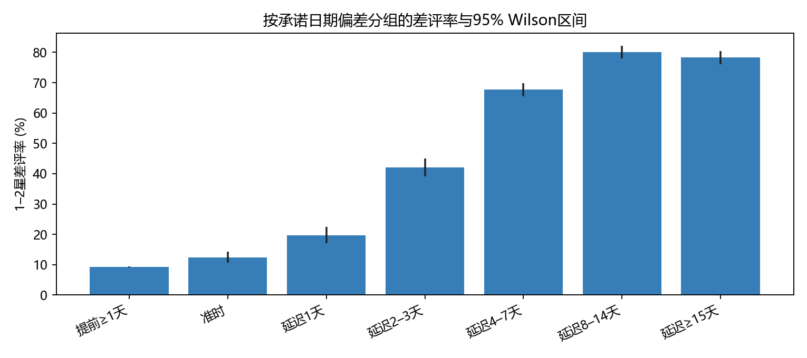

# Olist 履约时效：统计审计与业务深度研究

本报告为原项目的增量审计。原 `project/report.md` 和 `project/metrics.json` 保留。数据来自本地九张原始 CSV；本次结果由 `deep_audit.py` 实际运行生成。核心单位仍是订单。下文的“评价早于送达”专指 **review_answer_timestamp 早于记录的实际送达时间**，不能直接认定客户真的在收货前作答，也可能有送达回填或时钟问题。

## 执行摘要：新证据是什么

原报告的“延迟与差评强关联”得到独立模型复现，但**关联强度对评价与送达的时间先后极为敏感**。有评价的延迟订单 6,381 笔中，4,473 笔（70.1%）的评价回复时间早于记录的送达时间，这组差评率为 80.75%（3,612/4,473）；延迟且评价回复在送达之后的 1,908 笔，差评率为 19.44%（371/1,908）。只分析后者及相应的未延迟订单，控制原模型变量后的延迟 OR 从 16.30 降至 **2.40**（95% CI 2.13–2.70）。这提示原强关联很大部分与“评价时尚未记录送达”的状态同现。排除该组会改变目标总体，也可能产生选择偏差，不能把 2.40 称为校正后的因果效应。

更细的日期偏差显示，差评率从提前至少一天的 9.22%、准时的 12.42%，升至晚 1 天的 19.63%、晚 2–3 天的 42.05%、晚 4–7 天的 67.68%、晚 8–14 天的 80.15%；晚至少 15 天为 78.35%。客户等待状态和延迟程度比单一“是否晚到”更适合运营监控。

## 1. 原口径审计与修正

### 品类 NULL 混合

原 SQL 用 `COUNT(DISTINCT product_category_name)=1` 判断单品类，SQL 会忽略 NULL。同一订单中一部分商品类目为空、一部分是同一非空类目的订单会被误列为单品类。实际共有 **59** 笔这样的订单，已送达且有时间的 **57** 笔，有评价的 **55** 笔。旧单品类有评价样本 93,781，修正后要求 `NULL` 商品数为零，剩 **93,726** 笔；原模型可进入单品类回归的样本由 93,779 降为 **93,724**。重新加入主要品类控制后，延迟 OR **16.65**（95% CI 15.68–17.68），旧版为 16.63，方向和量级未改变。新的品类优先级表采用严格规则；多品类或部分缺类目订单不被任意归类。

### 物流时间

有效已送达订单中，下单至交接物流商为负的 **165** 笔，缺交接时间 **1** 笔，交接至送达为负的 **23** 笔。阶段耗时分析剔除这些无效时序，共 **96,281** 笔，但保留异常标记与原有订单，不修改原始数据。有效阶段样本的交接时长中位数 **2.20 天**、90 分位 **6.40 天**；运输阶段中位数 **7.10 天**、90 分位 **18.91 天**。原报告交接中位数 2.20 天只作全体非空记录描述；本次给出经过时间顺序检查的有效阶段口径。

### 独立回归复现与用户内相关性

statsmodels 二元 GLM 在同样的 95,822 笔、12,271 个差评事件上收敛，延迟系数 **2.791135**，常规 SE **0.030241**，OR **16.2995**（95% CI 15.3615–17.2948）；旧 SciPy OR **16.2997**，差 **0.00023**。statsmodels 经 6 次 IRLS 迭代收敛，最终最大绝对 score 分量约 **3.3×10⁻¹⁰**。两种实现实质一致。

关联 `customer_unique_id` 后有 **92,746** 个不同用户。用户聚类稳健 SE **0.030307**，比常规 SE 高 **0.22%**；对应 OR 不变，95% CI **15.3595–17.2971**。在当前重复购买结构下，用户内相关性对这一个系数的区间影响很小；这不证明观测独立或混杂已消除。

原 AUC 0.725 是训练样本表观值。另用 2017 年及之前订单训练、2018 年 1–8 月订单测试一个简化的回顾性评分风险模型（不使用购买月份哑变量），训练 **43,360** 笔、测试 **52,462** 笔，测试 AUC **0.734**、Brier 分数 **0.0930**，测试差评率 13.37%、平均预测概率 13.16%。该模型使用**实际送达后才能确定的延迟变量**，只能衡量事后风险区分，不能作为下单时或运输中的前瞻预测效果；时间切分也不能代替跨平台或未来年度验证。

## 2. 延迟程度与评分风险

| 相对承诺日期 | 有评价订单 | 差评订单 | 差评率 | Wilson 95% CI |
|---|---:|---:|---:|---:|
| 提前至少 1 天 | 88,163 | 8,130 | 9.22% | 9.03%–9.41% |
| 准时 | 1,280 | 159 | 12.42% | 10.73%–14.34% |
| 延迟 1 天 | 820 | 161 | 19.63% | 17.06%–22.49% |
| 延迟 2–3 天 | 1,032 | 434 | 42.05% | 39.08%–45.09% |
| 延迟 4–7 天 | 1,748 | 1,183 | 67.68% | 65.45%–69.83% |
| 延迟 8–14 天 | 1,446 | 1,159 | 80.15% | 78.02%–82.13% |
| 延迟至少 15 天 | 1,335 | 1,046 | 78.35% | 76.06%–80.48% |

这是描述性分组。控制客户州、购买月份、金额、运费、件数且按用户聚类标准误后，以准时为参照，晚 1 天 OR **1.65**（95% CI 1.29–2.11）、晚 2–3 天 **5.17**（4.18–6.39）、晚 4–7 天 **14.81**（12.14–18.06）、晚 8–14 天 **27.70**（22.33–34.36）、至少 15 天 **23.23**（18.71–28.85）。8–14 天与至少 15 天之间的系数差异双侧 p≈**0.063**，证据不足以声称最后一档确实回落；整体形态显示强非线性、后段趋于高位。

## 3. 评价时间顺序：原结论的关键边界

95,824 笔有评价已送达订单中，评价回复时间早于送达时间 **4,653** 笔；评价创建时间早于送达 **8,140** 笔。创建时间可能是平台发出评价请求的时间，不能等同于用户打分时间。四组数据如下：

| 配送 | 回复相对送达 | 订单 | 差评 | 差评率 |
|---|---|---:|---:|---:|
| 未延迟 | 送达后或同时 | 89,263 | 8,258 | 9.25% |
| 未延迟 | 送达前 | 180 | 31 | 17.22% |
| 延迟 | 送达后或同时 | 1,908 | 371 | 19.44% |
| 延迟 | 送达前 | 4,473 | 3,612 | 80.75% |

延迟订单中的差评有 **3,612/3,983（90.7%）** 落在“回复早于记录送达”组。若排除这一时间顺序异常，主调整 OR **2.40**（95% CI 2.13–2.70；n=91,170）；若更严格要求评价创建日期不早于送达，则 n=87,683，OR **2.22**（95% CI 1.89–2.61）。这些是不同条件样本的关联，不能认为条件筛选消除了偏差。经营上应先核查实际收货确认与评价邀请时间，并区分“未收到货时的投诉”与“收到货后的体验评价”。

## 4. 发货交接与运输阶段

在 96,281 笔时间顺序有效的订单中，未延迟组下单至交接物流商中位 **2.15 天**、交接至送达中位 **6.95 天**；延迟组分别为 **3.50 天** 与 **26.20 天**。交接阶段延长存在，但延迟组与未延迟组的运输阶段中位差更大。它们与总配送时长共享组成部分，不能据此分解因果责任。

`shipping_limit_date` 是商品级的商家发货期限。对多商品订单，使用**最晚**期限；只有交接物流商时间晚于订单所有商品期限，才标记为“全部期限之后交接”。在有效阶段样本的 **8,696** 笔该类订单中，1,814 笔最终超过客户承诺日期（20.86%）；其余 87,585 笔有 4,717 笔超期（5.39%）。这是一项值得核查的阶段信号，但商品级期限未必等同于真实揽收 SLA，且订单交接时间不能分配给某一个卖家。

对单卖家且阶段时间有效的线路，SP 卖家州→RJ 客户州有 **8,034** 笔、**1,147** 笔超期（14.28%），交接中位 2.33 天、运输中位 9.13 天；SP→SP 有 30,278 笔、1,424 笔超期（4.70%），相应为 2.17 天、3.56 天。地区距离、承诺日期和线路构成均可能不同，不能把线路差异直接归于承运商表现。多卖家订单 **1,275** 笔保留在订单履约统计，但不做单卖家线路归因。

## 5. 排查优先级与验证计划

**第一优先：评价与收货确认时间链。** 4,473 笔延迟订单在记录送达前已有评价回复，其中 3,612 笔差评。这是最具体的新风险群：核对评价邀请触发规则、真实签收与系统回填、在途异常通知。先做事件日志抽样，确认时间戳语义与记录延迟，再决定是否对“尚未确认送达且接近承诺日期”的订单试验主动沟通。

**第二优先：高延迟天数队列。** 晚 2–3 天差评率已达 42.05%，晚 4–7 天达 67.68%。在第 1 天与第 2–3 天设工单分级和预计到达信息更新，试验前固定触发时点、差评率、评价覆盖率、投诉率和成本。不能把观察到的组间差异换算成可实现收益。

**第三优先：高规模地区与线路。** SP 客户州有 1,786 笔延迟，RJ 有 1,456 笔，二者合计占有评价延迟订单约 50.8%；RJ 比率更高，SP 绝对量更大。SP→RJ 的单卖家线路有 1,147 笔延迟，适合沿仓库、承运商、里程和承诺日期继续拆解。当前数据缺仓库、承运商和真实揽收扫描，无法直接归责。

**第四优先：规模化品类复核。** 严格单品类口径下，`cama_mesa_banho` 有 8,976 笔、663 笔延迟；`beleza_saude` 有 8,530 笔、632 笔延迟。先检查商品尺寸、包装与线路结构，再评估品类专属发货承诺或承运能力。此处是规模筛查，没有多重比较校正，不能当作单个品类的因果超额风险。

## 方法边界和自我审计

已验证事实：源表行数、订单唯一性、NULL 混合数、时间异常数、组别分子分母、模型收敛与梯度、用户聚类 SE、时间切分指标均由代码运行生成。统计关联：延迟程度与差评率、阶段信号与超期、州与线路差异。业务假设：评价触发时点、收货确认回填、物流线路瓶颈。无法识别：延迟对评分的净因果效应、商家或承运商责任、任何可实现收益。

本研究仍有明显局限：评价缺失并非随机；送达时间可能回填；`shipping_limit_date` 是商品级期限；无承运商、仓库、里程、客服和实际签收扫描；线路和品类分析未做层级收缩或多重检验；时间切分只验证事后分类的区分能力。最应优先补充的是订单事件日志，而不是进一步堆叠回归变量。原报告主 OR 在其原口径下正确，但若被解释成“收货后对延迟的反应”，则明显超出了数据支持范围。
