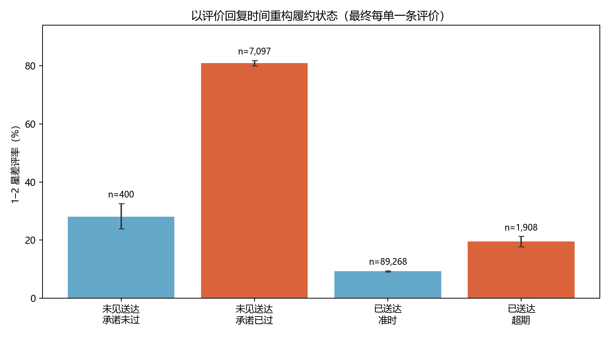

# Olist 电商履约时效与用户差评风险分析

面向数据分析 / 经营分析校招的统一交付稿。本报告整合基础分析、深度统计审计和评价时序研究，使用已运行结果，不增加研究或模型。[关键指标证据索引](EVIDENCE_INDEX.md)逐项列出代码、输出、分子分母及口径。

## 管理层摘要

1. 99,441笔订单中，96,478笔快照状态为delivered；其中8笔缺实际送达时间，96,470笔用于配送日期分析，6,534笔超过承诺日送达，延迟率 **6.77%**。
2. 上述样本中有评价95,824笔：最终延迟订单差评率 **62.42%**（3,983/6,381），未延迟订单 **9.27%**（8,289/89,443）。统计控制后关联仍存在，但不能解释为因果效果。
3. 时间审计改变了经营解释：原样本4,653笔收货前评价中，4,429笔评价时已过承诺日期，224笔尚未到期。应区分“失约后仍等待”与“收货后的超期体验”。
4. 在13,126笔承诺节点时尚未首次评价的候选订单中，未见送达组后续30天**评价者**差评率 **69.26%**（5,501/7,943），已送达组 **13.09%**（537/4,101）。这是更接近监控时点的后续关联，仍受问卷触发、取消与作答选择影响。
5. 优先建议核对事件日志，定义“过承诺日、仍活跃、未确认送达”队列，再试验主动告知或异常工单。项目没有上线监控、实施实验、降低差评或证实收益。

## 业务问题与数据边界

平台需要知道履约表现、低评分集中在哪里，以及何时可以识别值得排查的订单。本项目依次回答“最终配送结果与评分是否关联”“关联能否被统计控制后复现”“评价发生时客户究竟处于什么履约状态”。研究从结果关联转向时点明确的风险识别，不把历史结果替代实时特征。

数据为Olist发布的2016–2018年匿名公开交易数据，原始九表分别为订单、客户、商品明细、支付、评价、商品、卖家、地理位置和品类翻译。数据下载与授权请遵守[发布者数据页面](https://www.kaggle.com/olistbr/brazilian-ecommerce/home/)的条款；本项目不附原始CSV。缺少承运商、仓库、取消事件时间、数据入库时间和承诺修改历史，无法重构完整实时状态或归因责任。

## 数据可信度与订单级建表

SQLite先把商品、支付和评价聚合至订单，再关联订单与客户；关联后assert订单数量及order_id唯一。商品和支付的候选键分别为(order_id, order_item_id)、(order_id, payment_sequential)。地理邮编不唯一，不直接JOIN原地理明细表。customer_id在本数据中对应订单，customer_unique_id用于识别重复购买。

评价有99,224条、98,673个订单、98,410个评价ID：789个ID对应多订单、547个订单有多个评价ID、202个订单评分不一致；订单–评价ID组合与完全相同评价行均无重复。不能全局按review_id去重，也不能把无评价当作好评。基础口径按每单最晚review_answer_timestamp取评分，同刻用review_id确定顺序，1–2星为差评；有评分争议的方案单独作敏感性分析。

关键修正：原COUNT(DISTINCT 类目)忽略NULL，使55笔有评价订单被误判为单品类。严格规则要求“非空类目数=1且NULL商品数=0”，单品类有评价样本由93,781变为93,726；加入品类控制后的OR约16.65，结论方向稳定。多卖家订单不任意归给单个卖家。

配送阶段分析另标记165笔负交接时长、23笔负运输时长及1笔缺交接时间，阶段有效样本为96,281。异常仅从相应阶段时长指标中排除，原始数据与订单记录保留。96,470仅表示有实际送达日期，不是“全部字段无异常”。另有6笔取消订单有送达时间，基本配送样本仍按delivered状态定义。

## 样本与指标口径

| 用途 | 人群/分母 | 与其他阶段的区别 |
|---|---:|---|
| 原始订单审查 | 99,441 | 全部快照状态 |
| 配送日期分析 | 96,470 | delivered且实际送达非空 |
| 基础评分关联 | 95,824 | 上述订单中有评价；646笔无评价不进入评分分母 |
| 主Logistic回归 | 95,822 | 再排除2笔稀疏购买月份订单 |
| 阶段耗时 | 96,281 | 交接/运输时间顺序有效 |
| 评价时状态研究 | 98,673 | 全体有评价订单，含未完结、取消、送达缺失 |
| 承诺节点后续首次评价 | 13,126 | 节点已下单、尚未首次评价；不用未来是否评价决定资格 |

承诺日全部为午夜，按日终失约：实际送达日超过承诺日才算延迟，承诺日当日仍算未过期。直接按完整送达时间与预计午夜比较会得到8.11%，而日级口径为6.77%。快照delivered占比97.02%不能当作成熟订单队列的最终履约率。

## 履约、评分与风险规模

有效已送达订单配送时长中位10.22天、90分位23.10天。时间顺序有效阶段样本中，下单至交接中位2.20天，交接至送达中位7.10天。无评价的646笔有效送达订单延迟率23.68%，有评价订单为6.66%，评价缺失明显与配送结果相关。

图中分母是最终已送达且有评价订单。延迟差评率62.42%与未延迟9.27%的风险比6.74（95% CI 6.55–6.93），不代表消除延迟可以减少同等数量差评。Fisher检验p值在计算中下溢为0，应读作极小而非数学意义上的零。

描述性分组中，晚1天差评率19.63%，晚2–3天42.05%，晚4–7天67.68%，晚8–14天80.15%，至少15天78.35%。后两组调整系数差异p约0.063，不能据此声称长期延迟后的风险下降。评价时点的构成差异也可能贡献该曲线。

地区/品类/线路用于规模筛查：RJ客户州有评价订单12,211笔、延迟1,456笔；SP州延迟1,786笔，绝对量更大。严格单品类下，cama_mesa_banho有8,976笔、663笔延迟，beleza_saude有8,530笔、632笔延迟。单卖家且阶段时间有效的SP→RJ线路8,034笔、1,147笔延迟，运输中位9.13天；不能把订单级运输时间直接定责到卖家。各名单未经层级收缩或多重比较校正，不用于直接处罚。

## 统计方法、诊断及稳健性

二元Logistic控制客户州、购买月份、log1p商品金额、运费与件数。statsmodels独立复现主模型OR **16.2995**（95% CI 15.36–17.29），与SciPy实现16.2997一致，最大绝对score约3.3e-10；用户聚类SE比常规SE增加约0.22%。OR是赔率比，不是概率倍数或风险比，聚类SE也不解决未观测混杂。

将3星纳入、取最低/最高评分、排除冲突评价或严格单品类等敏感性分析中，关联方向稳定。信息矩阵条件数较高，模型设定、稀疏哑变量和未观测因素仍有局限。原训练集AUC约0.725仅是表观值；深度研究的时间切分AUC约0.734仍使用最终延迟变量，只代表事后区分，不能作为下单或在途预警能力。

深度报告排除收货前作答后得到OR约2.40，是换了条件人群后的关联，不能称为消除了偏差。另一个按创建时间不早于送达时间筛选的历史OR约2.22，混用了日期级创建字段与秒级送达字段，统一稿不采用它作为核心结论。历史输出保留以展示审计轨迹。

## 评价时点：从最终结果到当时状态

review_answer_timestamp作为评分提交时点代理。review_creation_date的99,139/99,224条为午夜，85条为01:00:00，按日期解释；预计送达全部午夜；四个字段无明确时区，未强行指定或转换。CSV送达字段是事件时间，不是入库时间，下表“已/未见送达”均是记录时序代理。

| 评价时状态 | 订单 | 差评 | 差评率 | Wilson 95% CI |
|---|---:|---:|---:|---:|
| 评价时未见送达，承诺日期未过 | 400 | 112 | 28.00% | 23.83%–32.59% |
| 评价时未见送达，承诺日期已过 | 7,097 | 5,749 | 81.01% | 80.08%–81.90% |
| 评价时已送达，按承诺日期准时 | 89,268 | 8,262 | 9.26% | 9.07%–9.45% |
| 评价时已送达，超过承诺日期 | 1,908 | 371 | 19.44% | 17.73%–21.28% |

四组共98,673笔，范围比原已送达样本大。未见送达组含最终仍缺送达时间和取消/缺货订单，不能直接解释为全部在途。61笔明显顺序矛盾都在“承诺未过、未见送达”组；敏感性排除后该组剩339笔，差评率21.24%，其他三组不变。正常收货前评价没有被删除。

同日评价与送达1,373笔，其中414笔作答时间在前、959笔在后或同时。把同日或相距±1/6/12/24/48小时的记录单列为顺序待定后，逾期未见送达组差评率仍约81%；窗口并不证明时区一致，也不改变缺失送达的含义。每单改取首次评价，主要差异仍在。

原95,824笔样本的4,653笔收货前评价中，4,429笔评价时已逾期，失约当时即可判断；224笔未到承诺日，最终是否延迟未知（180笔最终准时、44笔最终延迟）。所以不能把所有收货前评价都称为泄漏，但在下单时使用最终延迟以及对这224笔作时点解释时，确有未来信息问题。发布者描述到期也可发问卷，失约等待中的反馈有独立业务意义。

## 承诺节点与后续30天首次评价

统一观察点为承诺日期次日00:00。购买日>=2017-01-01，承诺日2017-01-01至2018-06-30；节点已下单、没有更早首次评价。候选资格不根据最终评分、是否最终送达或未来是否评价筛选；后续窗口为[节点,节点+30天)。13,126是跨节点累计候选，不是某天积压存量。

| 节点状态代理 | 候选订单 | 后续首次评价 | 其中差评 | 评价覆盖率 | 评价者差评率（95% CI） |
|---|---:|---:|---:|---:|---:|
| 未见送达 | 8,248 | 7,943 | 5,501 | 96.30% | **69.26%**（68.23%–70.26%） |
| 已送达 | 4,878 | 4,101 | 537 | 84.07% | **13.09%**（12.10%–14.16%） |

69.26%与13.09%仅针对后续作答者。全体候选中观察到首次差评事件比例分别为66.69%与11.01%，不能将未作答解释为满意。未见送达组有2,431笔最终仍无送达时间，取消/缺货可能混入；缺少取消事件日志无法还原真实活跃队列。较早截止日期减少数据尾部截断，但正式抽取时间未知，完整随访仍无法保证。两套SQL/Pandas汇总已独立核对。

## 运营优先级与实验验证设计

| 优先级 | 建议与依据 | 实施前验证 | 后续验证方式（未执行） |
|---|---|---|---|
| 1 | 核实承诺、签收、入库、取消与问卷时间链 | 时区、回填、事件时间和系统可用时间、承诺修改 | 抽样核对源系统日志，制定异常率和日志完整率 |
| 2 | 定义过承诺日仍活跃且未确认送达的队列 | 剔除当时已取消/缺货；按超期日分级，避免用未来信息 | 对节点候选随机分配常规流程与主动告知/异常工单 |
| 3 | 复核RJ、SP→RJ及高绝对量品类 | 仓库、承运商、距离、商品体积、承诺设置 | 在线路/团队存在干扰时考虑群组随机化；禁止依据本名单直接定责 |

实验方案须事前固定人群、触发时点、随访窗和主要指标。可将30天观察到首次差评事件、评价覆盖率、评价者差评率、投诉与客服成本一起报告；不能通过抑制问卷来改善表面指标。实验样本量需基于实际业务基线、最小可检测效果和聚类结构计算，本项目未计算或执行。只有实验或其他可识别设计支持后，才讨论净效果与成本收益。

## 结论可靠范围与尚未完成事项

较可靠：已记录样本内的订单计数、日期口径、组别分子分母；延迟/失约等待与低评分存在明显关联；问卷时点会显著改变业务解释。有限支持：地区、品类、线路名单可作为排查候选；承诺节点队列具有后续低分集中现象。

不能支持：延迟净因果效应、商家或承运商责任、前瞻预警性能、实时积压真实历史、降低差评或经营收益。主要限制包括观察性混杂、问卷触发与评价选择、时间精度与入库时间缺失、最终状态筛选、缺少取消历史和数据末端截断。区间未涵盖这些系统性不确定性。

完整复现记录见[复现说明](REPRODUCIBILITY.md)与[机器记录](reproducibility.json)。发布准备与Git检查见[交付清单](DELIVERY_CHECKLIST.md)。本统一稿不替换历史报告；历史中被审计限定的解释以本稿及证据索引为准。
