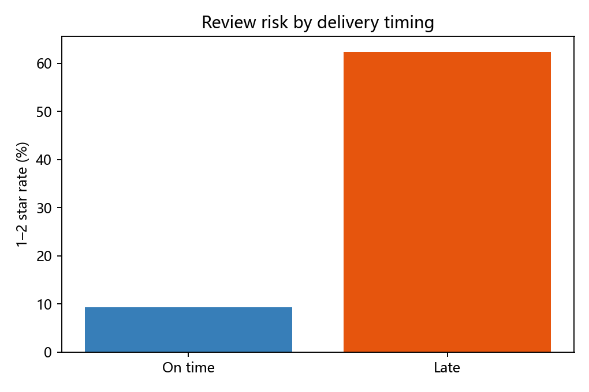
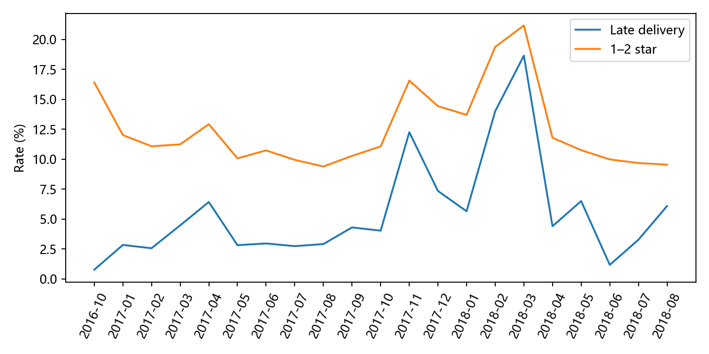
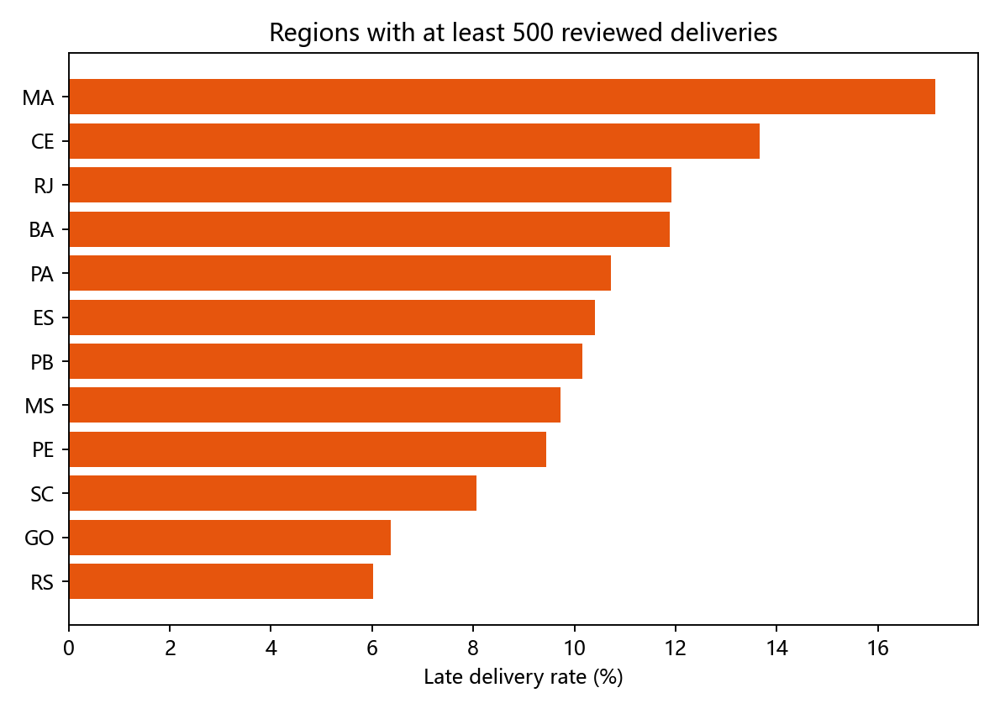

# Olist 电商履约时效与用户差评风险分析

## 管理层摘要

在 99,441 笔订单中，96,478 笔标记为已送达（97.02%）。其中 8 笔缺少实际送达时间，故 96,470 笔进入配送时效分析；6,534 笔晚于承诺日期送达，延迟率为 **6.77%**。有评价的 95,824 笔已送达订单中，按每单最终回复时间对应评分、1–2 星定义差评，差评率 **12.81%**。延迟订单差评率 **62.42%**，未延迟订单 **9.27%**；风险比 **6.74**（95% CI 6.55–6.93）。控制客户州、购买月份、商品金额、运费和件数后的 Logistic 关联 OR 为 **16.30**（95% CI 15.36–17.30）。这说明延迟是值得优先排查的风险信号，不能据此认定延迟本身造成全部评分差异。

## 研究问题和方法

研究平台履约表现、延迟与低评分的关联、地区/品类/卖家的风险集中，以及统计控制后的稳健性。以订单为核心单位，SQLite SQL 先将商品、支付、评价汇总到订单，再与订单主表连接。评价最终口径采用每单最晚 `review_answer_timestamp` 的评分；对冲突订单做最低分、最高分及排除敏感性分析。日期型预计送达值只用日期比较，避免午夜时间戳误判。评价缺失不等于好评。

## 数据质量与样本变化

九张原始表的字段、候选键、缺失和关联详见上级目录 `data_quality_review.md` 与 `audit_results.json`。订单 `order_id` 唯一；评价有 789 个 ID 对多个订单、547 个订单对多个评价 ID、202 个订单评分冲突；没有重复订单–评价 ID 组合或完全相同的评价行。评价 ID 全局去重会损失跨订单信息，因此不使用。交付前出现承运商时间早于下单时间的有效送达订单有 165 笔，另有 1 笔缺承运商时间；物流商时长只作描述，未用于主模型。

样本流：99,441 总订单 → 96,478 `delivered` → 96,470 有实际送达时间 → 95,824 有评价 → 95,822 进入主模型（2 笔来自不足 100 单的稀疏购买月份，被排除以减少分离风险）。无评价的 646 笔配送候选订单延迟率 **23.68%**，有评价订单为 **6.66%**，说明评价选择偏差可能显著；评分关联仅适用于有评价样本。

## 核心经营指标与探索发现

以全部订单为分母，已送达率 97.02%，有实际送达时间的履约记录占 97.01%。有效已送达订单从下单到送达中位数 **10.22 天**、90 分位 **23.10 天**；下单到交付物流商时间中位数 **2.20 天**。按日期判断的延迟率 6.77%；如果错误地用完整时间戳与预计日期午夜比较，会得到 8.11%，说明日期口径有实质影响。

延迟组 6,381 笔有评价订单中 3,983 笔差评；未延迟组 89,443 笔中 8,289 笔差评。图显示的组间差异有明确规模支持。Fisher 精确检验的计算结果低于双精度可表示范围（脚本输出为 0），应表述为极小而非概率真的为零。

按购买月份看，2018 年 3 月的有评价已送达订单延迟率 **18.65%**（1,296/6,948），差评率 **21.17%**；2018 年 2 月分别为 14.02% 和 19.38%。这是值得追查的运营时段，但订单可能跨月送达，不能直接当作某月仓配绩效。

地区按客户州统计。RJ 有 **12,211** 笔有评价已送达订单，其中 **1,456** 笔延迟（11.92%），差评率 18.33%；MA 延迟率更高（122/712，17.13%），但量级小得多。报告优先级兼顾比例和受影响规模，不按比例单独排名。

单品类订单中，`cama_mesa_banho` 有 8,981 单、663 单延迟、差评率 15.56%；`beleza_saude` 有 8,532 单、632 单延迟、差评率 11.24%。`moveis_escritorio` 有 1,229 单、99 单延迟、差评率 21.56%。单卖家订单中，卖家 `06a2c3af7b3aee5d69171b0e14f0ee87` 有 384 单、71 单延迟（18.49%）；这些是排查候选，不代表商家可独立控制配送。多品类 719 单、多卖家 1,261 单未被任意分配给单一实体。完整结果及 Wilson 区间见分组 CSV。

## 统计推断与模型诊断

未调整风险比 6.74（95% CI 6.55–6.93）。二元 Logistic 模型以 1–2 星为因变量，延迟为主要解释变量，控制客户州、购买月份、`log1p` 商品金额、运费和件数。主模型 **n=95,822**、差评事件 12,271，优化收敛；调整 OR 16.30（95% CI 15.36–17.30），表观 AUC 0.725。OR 与风险比量纲不同，不能读作风险提高 16 倍。模型信息矩阵条件数约 88 万，提示部分哑变量相关或稀疏，标准误应谨慎使用；AUC 为训练样本表观值，没有外部预测验证。

敏感性：将 3 星纳入低评分，调整 OR **12.66**（95% CI 11.92–13.45）；排除评分冲突订单，OR **16.36**；每单取最低分/最高分，分别 **16.27/16.31**。限制为单品类订单并加入主要品类控制，n=93,779，OR **16.63**（95% CI 15.66–17.66）。方向和数量级稳定，但不同样本或结局口径的 OR 不应直接比较为运营效果。

## 业务风险优先级与行动

1. **先排查高规模延迟来源**：RJ 的 1,456 笔延迟有规模意义；结合 2018 年 2–3 月高延迟时段，按物流线路、承运商、仓库和预计日期生成规则继续拆解。当前九表没有承运商和仓库标识，无法直接定位责任节点。
2. **监控临近承诺日期的订单**：建立每日按承诺日期的待交付、在途和已延迟队列，对高风险订单触发客服告知与异常工单。先验证触达是否改善满意度，避免把本研究 OR 换算为可实现收益。
3. **品类与商家分层排查**：优先复核订单规模和延迟绝对数均较高的 `cama_mesa_banho` 与 `beleza_saude`；对高延迟单卖家候选检查发货与物流衔接。多卖家订单需拆为商家履约事件分析，不能用订单评分给单个卖家定责。

建议后续在部分可比地区或物流线路随机分配预警/主动沟通方案，事前固定样本、主要指标（按订单计差评率与延迟率）、观察窗和最小可检测效果；同时监控成本及投诉转移。预警方案可能改变评价提交概率，应同步分析评价覆盖率。

## 局限与严格自评

这是观察性数据：未观测的物流线路、仓库、客服、商品质量和客户预期可能共同影响延迟与评分。预计送达日期是承诺值，可能随地区或商品策略而变化。样本仅含已送达且有评价订单，评价缺失与延迟明显相关；不能外推到全部订单或做因果声明。品类和卖家列表是描述性筛查，未对多重比较或州内、品类内的复杂混杂做正式校正；小样本高风险名单不宜直接用于处罚。模型没有样本外验证，亦未完整建模评论文本和时空效应。

自评 **78/100**：数据粒度与口径处理、SQL 订单级汇总、关联检验和敏感性分析达到可展示水平；缺少承运商/仓库等关键运营变量，评价选择偏差未被因果方法识别，细分群体未做多重检验和层级收缩，图表偏基础，求职展示还需强化问题到决策的叙事。代码和核心结果均已实际运行；后续实验、收益量化和外部验证未执行。
